<!--
  Todos os painéis deste perfil são SVGs gerados por gen/ (Python, sem dependências)
  e redesenhados a cada 3 horas pelo .github/workflows/profile.yml com dados ao vivo da API do GitHub.
-->

<p align="center">
  <a href="https://github.com/g-ssouza"></a>
</p>

<p align="center"><a href="https://github.com/g-ssouza"></a><a href="https://www.linkedin.com/in/gustavo-melos-souza-/"></a><a href="mailto:guudev102@gmail.com"></a></p>

### `$ whoami` &nbsp;·&nbsp; sobre

<p align="center">
  
</p>

Comecei a programar querendo entender **como as coisas funcionam por baixo**.  
Gosto da fronteira entre a lógica e a interface — onde o código vira algo real.

Hoje foco em **Java**, **MySQL**, **HTML** e **CSS**, organizando o trabalho com **Scrum**.  
Aprendo fazendo: montar, testar, quebrar e reconstruir até funcionar direito.

```diff
@@ bio.md · fix(bio): tirar os sapatos @@
- Prefiro trabalhar de sapato: camada atrás de camada entre eu e a máquina.
+ Prefiro trabalhar descalço: bare metal, nada entre eu e a máquina.
```

### `$ inventory --equipped` &nbsp;·&nbsp; stack

<p align="center">
  
</p>

### `$ ls ~/projects` &nbsp;·&nbsp; projetos

<p align="center">
  <a href="https://github.com/g-ssouza/Gerenciamento-Funcionario">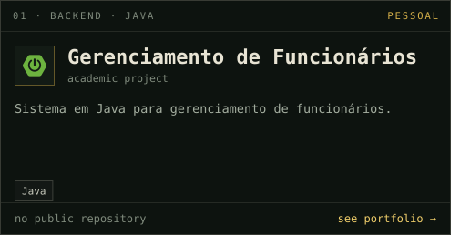</a><a href="https://github.com/g-ssouza/Gucode">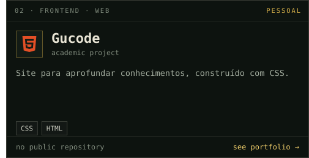</a>
</p>
<p align="center">
  <a href="https://github.com/g-ssouza/html">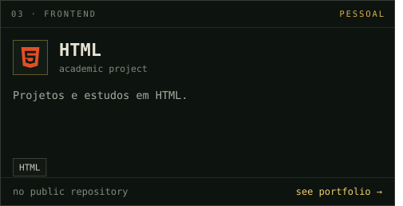</a><a href="https://github.com/g-ssouza/G.A.-Fitness">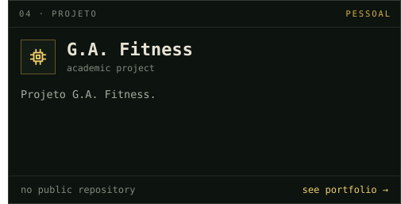</a>
</p>

### `$ gh status` &nbsp;·&nbsp; github

<p align="center">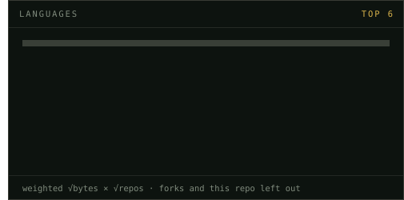</p>
<p align="center">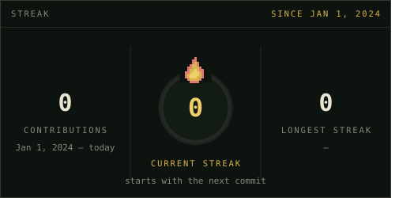</p>
<p align="center">
  
</p>
<p align="center">
  
</p>

### `$ ping gsouza` &nbsp;·&nbsp; contato

Quer conversar sobre código, Java, banco de dados ou oportunidades?  
Me chama no [LinkedIn](https://www.linkedin.com/in/gustavo-melos-souza-/) ou no e-mail [guudev102@gmail.com](mailto:guudev102@gmail.com).

<p align="center">
  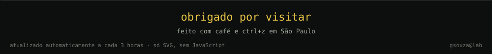
</p>
