<!--
  Every panel on this profile is an SVG drawn by gen/ (Python, no dependencies)
  and redrawn every 3 hours by .github/workflows/profile.yml with live numbers from the GitHub API.
-->

<p align="center">
  <a href="https://github.com/g-ssouza"></a>
</p>

<p align="center"><a href="https://github.com/g-ssouza"></a><a href="https://www.linkedin.com/in/gustavo-melos-souza-/"></a><a href="mailto:guudev102@gmail.com"></a></p>

### `$ whoami` &nbsp;·&nbsp; about

<p align="center">
  
</p>

Comecei a programar querendo entender **como as coisas funcionam por baixo**.  
Gosto da fronteira entre a lógica e a interface — onde o código vira algo real.

Hoje foco em **Java**, **MySQL**, **HTML** e **CSS**, organizando o trabalho com **Scrum**.  
Aprendo fazendo: montar, testar, quebrar e reconstruir até funcionar direito.

```diff
@@ bio.md · fix(bio): take off shoes @@
- I prefer working with shoes on: layer after layer between me and the machine.
+ I prefer working barefoot: bare metal, nothing between me and the machine.
```

### `$ inventory --equipped` &nbsp;·&nbsp; stack

<p align="center">
  
</p>

### `$ ls ~/projects` &nbsp;·&nbsp; projects

<p align="center">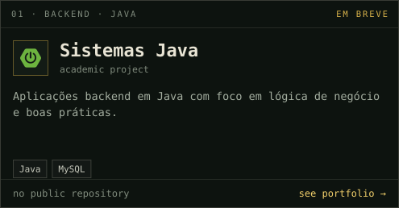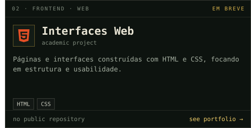</p>
<p align="center">
  
</p>

### `$ gh status` &nbsp;·&nbsp; github

<p align="center">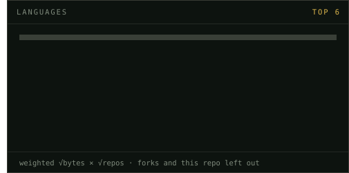</p>
<p align="center">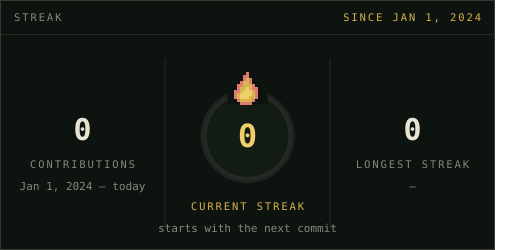</p>
<p align="center">
  
</p>
<p align="center">
  
</p>

### `$ ping gsouza` &nbsp;·&nbsp; contact

Quer falar sobre código, Java, banco de dados ou oportunidades?  
Reach me on [LinkedIn](https://www.linkedin.com/in/gustavo-melos-souza-/) or at [guudev102@gmail.com](mailto:guudev102@gmail.com).

<p align="center">
  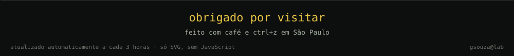
</p>
